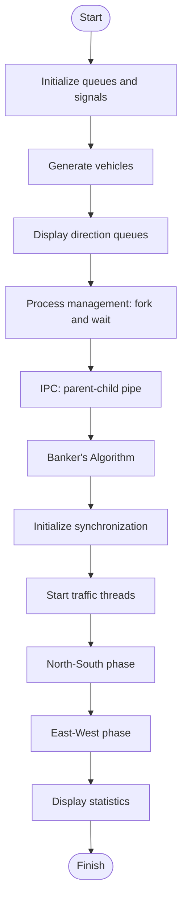

<div align="center">

<a href="https://github.com/Yougeshkumar7/Smart-Traffic-Intersection-Process-Simulator">
  
</a>

<br/>


**A terminal-based four-way traffic simulation demonstrating core Operating Systems concepts using C and Linux/POSIX APIs.**

</div>

---

## `01` — Project Overview

The simulator models a four-way intersection with separate queues for **North, South, East, and West**. It generates vehicles, manages traffic phases, and demonstrates how processes, threads, synchronization, IPC, and resource allocation work together.

## `02` — Features

| Feature | Description |
|---|---|
| 🚗 Vehicle generation | Generates cars, buses, trucks, ambulances, and motorcycles |
| 🚦 Traffic queues & signals | Maintains four direction queues and signal states |
| ⚙️ Process management | Creates child processes using `fork()` and collects them with `wait()` |
| 🔁 IPC | Demonstrates parent-child communication through a pipe |
| 🧵 Multithreading | Uses POSIX threads to process traffic |
| 🔒 Synchronization | Coordinates intersection access with a mutex and semaphore |
| 🧮 Banker's Algorithm | Checks whether a configured resource state is safe |
| 📊 Statistics | Tracks generated and processed vehicles and recorded waiting time |

## `03` — OS Concepts

```text
+----------------------+----------------------------------+
| OS CONCEPT           | USED IN THE PROJECT              |
+----------------------+----------------------------------+
| Process Management   | fork(), wait(), exit()           |
| IPC                  | pipe(), read(), write()          |
| Thread Management    | pthread_create(), pthread_join() |
| Synchronization      | Mutex and semaphore              |
| Resource Management  | Banker's Algorithm               |
+----------------------+----------------------------------+
```

## `04` — Simulation Flow



## `05` — Project Structure

```text
Smart-Traffic-Intersection-Process-Simulator/
├── docs/           # Project documentation
├── include/        # Header files (.h)
├── logs/           # Log files
├── scripts/        # Helper scripts
├── src/            # C source files (.c)
│   ├── main.c
│   ├── vehicle.c
│   ├── traffic_queue.c
│   ├── traffic_signal.c
│   ├── vehicle_generator.c
│   ├── process_manager.c
│   ├── ipc.c
│   ├── thread_manager.c
│   ├── synchronization.c
│   ├── resource_manager.c
│   └── statistics.c
├── tests/          # Test files
└── README.md
```

## `06` — Build & Run

**Requirement:** Ubuntu or another compatible Linux distribution with GCC.

Install build tools:

```bash
sudo apt update
sudo apt install build-essential
```

Compile from the project root:

```bash
gcc -Wall -Wextra -Iinclude src/*.c -pthread -o traffic_simulator
```

Run:

```bash
./traffic_simulator
```

## `07` — Example Terminal Output

```console
============================================
   SMART TRAFFIC INTERSECTION SIMULATOR
============================================

========== VEHICLE GENERATION ==========
Vehicle Generated Successfully!
Vehicle ID: 1001
Vehicle Type: 0
Direction: NORTH
Priority: 1

========== PROCESS MANAGEMENT ==========
Child Process ID: ...
Managing NORTH Traffic

========== FINAL STATISTICS ==========
Total Vehicles Generated: ...
Total Vehicles Processed: ...

       SIMULATION COMPLETED
============================================
```

## `08` — Platform Notes

This project uses Linux/POSIX APIs such as `fork()`, `wait()`, pipes, `getrandom()`, Pthreads, and POSIX semaphores. Run it in Ubuntu/Linux; it is not designed to compile directly as a native Windows application.

## `09` — Current Scope

- Four fixed traffic directions and a fixed queue capacity.
- Console-based simulation; no physical traffic lights or road sensors.
- IPC and Banker's Algorithm are educational demonstrations using configured example data.
- Waiting-time statistics depend on waiting times being updated and recorded by the simulation.

---

<div align="center">

**Yougesh Kumar**  
BS Software Engineering · Sukkur IBA University

[GitHub Repository](https://github.com/Yougeshkumar7/Smart-Traffic-Intersection-Process-Simulator)

*Built to explore processes, threads, IPC, synchronization, and resource management in C.*

</div>
